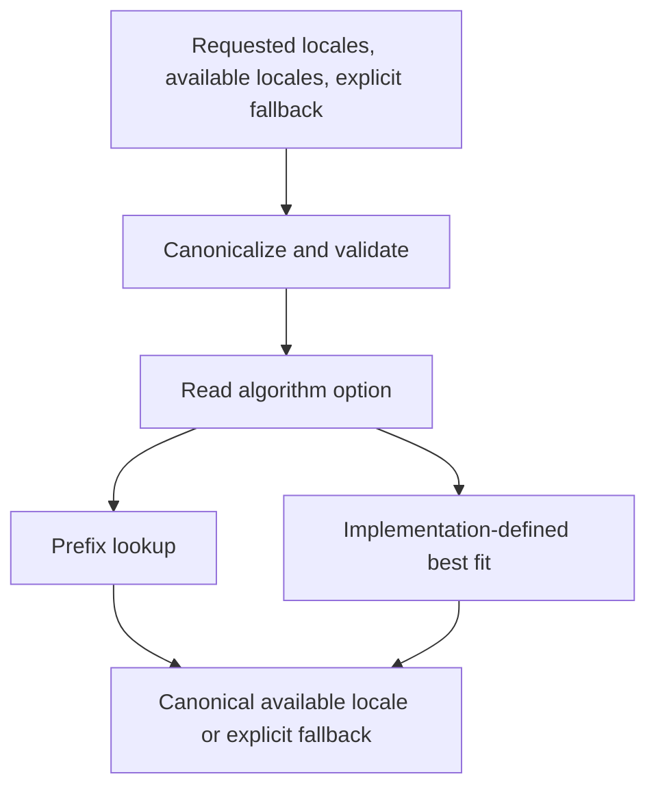

# LocaleMatcher working draft

Expose ECMA-402 locale matching for application resources. Keep linguistic data
and best-fit policy implementation-defined. This draft proposes API semantics;
it does not record committee consensus.

## Baseline

Read against ECMA-402 main at
[`3691634`](https://github.com/tc39/ecma402/tree/3691634ebc1794f2af74cb26e59824b21090c3ad),
retrieved 2026-10-31. Sections 9 and 9.2 now use
`LookupMatchingLocaleByPrefix` and `LookupMatchingLocaleByBestFit`, not the older
`LookupMatcher` and `BestFitMatcher` names.

- [Locale and Parameter Negotiation](https://tc39.es/ecma402/#sec-locale-and-parameter-negotiation)
  defines available lists and descending requested priority.
- [CanonicalizeLocaleList](https://tc39.es/ecma402/#sec-canonicalizelocalelist)
  supplies validation, canonicalization, duplicate removal, and observable reads.
- [Prefix matching](https://tc39.es/ecma402/#sec-lookupmatchinglocalebyprefix)
  supplies RFC 4647 lookup, ignoring requested Unicode locale extensions.
- [Best-fit matching](https://tc39.es/ecma402/#sec-lookupmatchinglocalebybestfit)
  is implementation-defined. It should be at least as good as prefix matching
  from a typical user's perspective. That is not a prescribed score or winner.
- [CoerceOptionsToObject](https://tc39.es/ecma402/#sec-coerceoptionstoobject)
  discourages its own use for new APIs in favor of `GetOptionsObject`.



## Proposed contract

Keep `Intl.LocaleMatcher.match(requested, available, fallback, options)` and the
`algorithm` option from the existing README. `Intl.LocaleMatcher` is a namespace
object, not a constructor. No persistent matcher API in this draft.

1. Canonicalize the complete requested list, then the complete available list.
2. Reject available entries containing an actual Unicode `u` extension.
3. Validate and canonicalize the required fallback as one locale-list element.
4. Read options using `GetOptionsObject`, then read `algorithm` once.
5. Match using the existing operation. Return its available tag, or fallback.

Validation completes before matching, including when either list is empty or
the first request would match. Getter/coercion exceptions propagate in this
order. Cache use cannot skip required observable reads on later calls.

### Available resources

Available lists are application input, not an engine's service locale registry.
Do not restrict them to `NumberFormat.supportedLocalesOf()` or similar lists.
Do not synthesize parent tags: an application with only `en-US` resources does
not thereby offer an `en` resource. The closure requirements on service
constructors' `[[AvailableLocales]]` do not apply here.

Canonicalization means returned strings can differ from the spelling of resource
keys. Applications must map canonical tags to their resources. Duplicates,
including equivalent aliases after canonicalization, collapse before matching.
Original resource keys and original alias spelling are not returned.

### Extensions

ECMA-402's Available Locales List excludes Unicode locale extensions. Rejecting
them at this boundary satisfies that precondition without silently merging
resources such as `en-u-ca-gregory` and `en-u-ca-hebrew`. This is a proposed
restriction, not existing committee consensus.

Requested `u` extensions are ignored for matching. The returned record's
`[[extension]]` is intentionally not appended: resource selection does not
negotiate service options. Thus a lookup request for `en-u-ca-buddhist` with
available `en` returns `en`.

Do not replace this with unconditional `baseName` extraction: that would also
discard transformed extensions and private-use subtags. In particular,
`en-x-u-co-phonebk` has private-use text, not a Unicode `u` extension.

Private-use tags remain accepted. Prefix lookup can select an exact private-use
resource. This draft does not require best fit to understand formal/casual tone
or any other private convention. Specialized extension matching remains
[issue #6](https://github.com/tc39/proposal-intl-localematcher/issues/6), discussed
at [TG2 in March 2021](https://github.com/tc39/ecma402/blob/main/meetings/notes-2021-03-11.md#extension-support-6).

### Fallback

Keep the explicit fallback argument. Missing, `undefined`, null, numeric, and
symbol values fail as invalid locale-list elements with TypeError. Malformed
strings fail with RangeError. An Intl.Locale or object coercible to a valid tag
is accepted through CanonicalizeLocaleList.

The fallback may be outside available resources, including when available is
empty. This preserves the existing API's separate fallback role and supports
callers that handle a distinct fallback path. It is not a candidate or
tie-breaker, and cannot change a successful selection. No host default is read.
An extension-bearing fallback is returned canonicalized, without matching or
extension removal; this exception to the available-tag restriction needs review.

### Best fit and data independence

Reuse the existing best-fit operation on the entire request list. Do not perform
an exact-match pass across all requests first: a later exact request should not
automatically override a suitable earlier preference. Do not prepend a separate
prefix pass either; doing so could bypass the implementation's best-fit policy.

Our CLDR/ICU research demonstrates possible implementations, not universal
answers. Language/script/region distances, one-way relationships, regional
clusters, request penalties, rejection thresholds, explicit-subtag tie scores,
paradigm ordering, and all numeric constants stay outside normative text.
No mandated maximization step, language-first priority, dataset, or version.

Existing ECMA-402 language-tag validation and canonicalization still apply,
including their Unicode dependencies. Data independence here means adding no
new CLDR dependency for matching; it does not remove existing normative references.

ICU-specific expected results belong in implementation tests. Test262 should
assert lookup results and API invariants without hardcoding ICU's best-fit
answers. Empty requested/available lists return fallback after validation.

## Candidate best-fit selection algorithm

This is a discussion alternative, not the algorithm required by `spec.emu`.
The normative draft still delegates to ECMA-402's existing best-fit operation.
Data independence does not require leaving selection mechanics unspecified.

A possible common selection algorithm takes a linguistic model containing:

- A directional distance `D(requested, available)`: a finite nonnegative value,
  zero for identical canonical tags after removing requested Unicode `u`
  extensions. It need not be symmetric or satisfy the triangle inequality.
- A finite nonnegative preference penalty `P` for each later request.
- A finite positive acceptance threshold `T`, in the same units as `D` and `P`.

These are internal model parameters, not new public options. No particular
dataset, maximization algorithm, language relationship, or numeric constant is
prescribed. Model values stay fixed during one invocation.

```text
best = absent
For each requested locale r at index i:
    Remove its Unicode locale extension sequence.
    For each available locale a at index j:
        score = D(r, a) + i * P
        If score >= T, skip this pair.
        If (score, i, j) precedes best's tuple, retain this pair.
Return retained available locale, or explicit fallback if no pair survived.
```

Scores here are mathematical values; this is not a floating-point precision or
loop-complexity requirement. Implementations can index, prune, and cache while
preserving observable input reads and selection results.

This makes selection and ties explicit while leaving linguistic data open. A
later exact match can beat an earlier weak match without an unconditional
exact-match pass across the request list. The explicit fallback does not enter
scoring. Equal scores prefer the earlier request, then available-list order.
That last tie policy is a proposal, not ICU's default/paradigm-locale ordering.

There are still substantive decisions: how `P` relates to ordinary regional
differences; how `T` separates acceptable from unrelated languages; which
constraints to place on `D`; and whether available order should decide ties.
Arbitrary values can still produce surprising results. A formula alone does not
establish linguistic quality or cross-engine equivalence. Moving this framework
into normative text would require reviewing the shared ECMA-402 best-fit
operation, since existing service constructors use it too.

The default penalty expresses a preference tradeoff, not an assumption that all
users have a strict, complete language ranking. An unordered acceptance set or
translation-completeness ranking would need a separate input contract.

## Open-issue review

All five open issues and their comments were reviewed for this draft. The
following are proposed dispositions, not resolutions; no issues are closed.

| Issue | Draft position | Remaining decision |
| --- | --- | --- |
| [#2: API placement](https://github.com/tc39/proposal-intl-localematcher/issues/2) | Keep the existing `Intl.LocaleMatcher.match` shape while drafting. LocaleMatcher is an ordinary namespace, with no instances. | Consider `Intl.matchLocale`; a constructor/prepared matcher needs its own reuse and data-loading rationale. |
| [#3: Use cases](https://github.com/tc39/proposal-intl-localematcher/issues/3) | Select application translation resources, including page-language matching for WebExtensions. Accept a single locale through CanonicalizeLocaleList. | Requested order is supplied by the caller; the API cannot infer unlisted languages, translation quality, or a user's unordered acceptance set. |
| [#4: Return type](https://github.com/tc39/proposal-intl-localematcher/issues/4) | Return a canonical String, consistent with supportedLocalesOf and resolvedOptions().locale. Accept Intl.Locale inputs. | Locale objects offer parsed fields, but lack value equality and add object allocation. Multiple results remain separate. |
| [#6: Extensions](https://github.com/tc39/proposal-intl-localematcher/issues/6) | Ignore requested Unicode `u` extensions; provisionally reject them on available resources. Preserve other subtags for the selected operation. | Private-use tone matching is not standardized here. Review resource identity before stripping extensions or assigning private-use semantics. |
| [#8: Multiple candidates](https://github.com/tc39/proposal-intl-localematcher/issues/8) | Keep one winner in this draft. | Define whether a future array means one winner per request, all acceptable resources, or a ranked message-fallback chain; also define deduplication and no-match handling. |

The unsupported-language examples in #3 are useful regression inputs: a shared
region is not by itself evidence that one language is a suitable substitute.
They are reports about a historical ponyfill, not evidence of current behavior
or required outputs for every implementation. A candidate distance model needs
independent conformance evidence and an explicit acceptance policy.

`Accept-Language` header parsing, quality weights, and wildcard ranges stay
outside the API, as discussed in #3. `navigator.languages` already supplies a
list; an HTTP header string is not a locale identifier.

The loop in #8 selects one winner for each requested locale, with a sentinel
fallback used to detect failure. It does not enumerate every acceptable resource
for each request. A future API should expose no-match directly rather than
requiring a fake default tag.

Fuchsia's catalog lookup illustrates the distinction: it calls ICU once per
request and searches the selected catalogs for each message. It does not build
every acceptable fallback. Fluent Filtering can collect multiple matches for
one request and uses a different matching policy. These are separate API needs,
not proof that either implementation is a drop-in equivalent of the other.
See [Fuchsia source](https://fuchsia.googlesource.com/fuchsia/+/refs/heads/main/src/lib/intl/lookup/rust/src/lib.rs),
[Fluent negotiation](https://docs.rs/fluent-langneg/latest/fluent_langneg/negotiate/),
and [ICU4X's matcher discussion](https://github.com/unicode-org/icu4x/issues/3023).

## Conformance plan

| Area | Portable assertions |
| --- | --- |
| Object shape | Ordinary namespace; not callable/constructible; descriptors, toStringTag, `match.length === 3`; receiver ignored |
| Lists | Same normalization as getCanonicalLocales; single string and Intl.Locale; array-like inputs; holes, inherited indexed properties, getters, proxies; no generic iterable contract |
| Validation | Complete requested list before available; complete available list before extension checks; fallback before options; no early-match short circuit |
| Errors | TypeError for invalid element types, missing fallback, null/primitive options; RangeError for malformed tags, available `u` extensions, invalid algorithm |
| Options | `undefined` defaults; inherited `algorithm`; one getter read; string coercion and abrupt completions; unknown properties ignored |
| Lookup | Exact, prefix truncation, request priority, singleton truncation, missing implicit parents, empty lists, no match |
| Output | Canonical available tag or canonical fallback; never append requested `u` extension; fallback may be outside available |
| Extensions | `en-u-ca-buddhist` versus `en`; `en-x-u-co-phonebk`; transformed extension and private-use prefix boundaries |
| Best fit | Returned non-fallback value belongs to canonical available input; requested `u` values cannot affect result; no engine-default substitution |
| Repeated calls | Mutations and observable getters are respected; no frozen-array, identity-only, or size-only cache assumptions |

There is no proposal implementation in this repository. This table is a test
plan, not a claim that the FormatJS ponyfill already implements this draft.

## Differences from the research implementation

FormatJS main at `cc09570` canonicalizes requests in the public `match` wrapper,
but passes available tags and fallback through to its resolver. The draft
canonicalizes and validates all three inputs. Applications relying on original
alias spellings would need to canonicalize resource keys.

The wrapper uses `opts?.algorithm || 'best fit'`. The draft instead follows
`GetOptionsObject` and `GetOption`: null/primitive options and invalid algorithm
values fail rather than being tolerated by that wrapper.

FormatJS also supplies its fallback to the ICU-style supported-locale ranking.
The draft does not pass fallback to the shared matching operation. Thus fallback
is only a failure result here; it is not an ICU default-locale tie preference.
This is an intentional proposed API choice, not a claim of ponyfill parity.

The private immutable snapshots and prepared indexes support efficient
implementations, but are not observable API requirements. Public locale lists
must still be read according to CanonicalizeLocaleList on each invocation.

## Open committee decisions

- Namespace versus `Intl.matchLocale` ([#2](https://github.com/tc39/proposal-intl-localematcher/issues/2)).
- `algorithm` versus the existing Intl option name `localeMatcher`.
- Reject available `u` extensions, strip them, or define matching of resources
  distinguished by them. Stripping requires a resource-identity policy.
- Required fallback, fallback outside available, eager validation, and whether
  fallback extensions should be rejected for symmetry.
- String versus Intl.Locale results
  ([#4](https://github.com/tc39/proposal-intl-localematcher/issues/4)).
- Single winner versus ordered candidates
  ([#8](https://github.com/tc39/proposal-intl-localematcher/issues/8)).
- Prepared matcher API: useful for repeated matching, but separate from exposing
  the existing operations. Benchmarks do not justify a timing guarantee.
- Stronger best-fit invariants, such as a mandatory exact-match guarantee, would
  need explicit consensus and review of the shared abstract operation. This
  draft does not silently strengthen existing ECMA-402 semantics.
