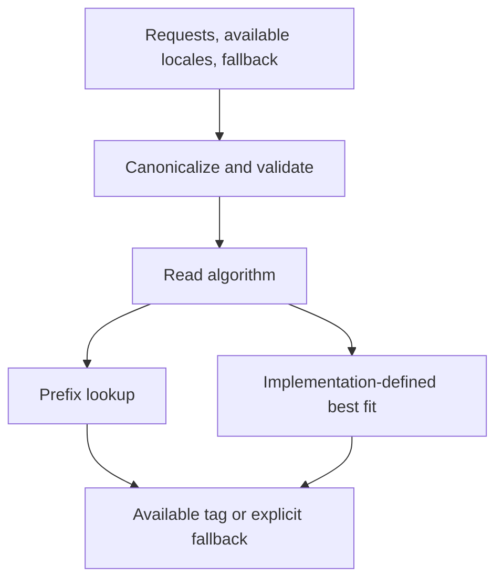

# LocaleMatcher design

Working draft, not committee consensus. Based on ECMA-402
[`3691634`](https://github.com/tc39/ecma402/tree/3691634ebc1794f2af74cb26e59824b21090c3ad).

## Contract

`Intl.LocaleMatcher` is an ordinary namespace. `match` returns one canonical
String; no instances or prepared matcher API.



Observable order:

1. `CanonicalizeLocaleList` on complete requested list, then available list.
2. Reject available tags containing Unicode `u` extensions.
3. Canonicalize fallback as one locale-list element.
4. `GetOptionsObject`, then `GetOption` for `algorithm`.
5. Call `LookupMatchingLocaleByPrefix` or `LookupMatchingLocaleByBestFit`.

Validate everything before matching, even for empty lists or an early match.
Preserve getters, coercion errors, duplicates/alias normalization, and mutations
across calls. Caches cannot skip observable reads; frozen arrays can have getters.

Available locales describe app resources, not engine formatter support. They need
no host default or parent tags: providing `en-US` does not create `en` resources.
Applications must map canonical tags back to their resource keys.

Fallback is required, eagerly validated, and used only after no match. It may be
outside available locales and contain extensions. It never enters scoring or
calls `DefaultLocale`. Missing/invalid element types throw TypeError; malformed
tags throw RangeError. `Intl.Locale` and coercible objects follow locale-list rules.

## Extensions and data

ECMA-402 available lists exclude Unicode `u` extensions. Rejecting these avoids
silently merging resources such as `en-u-ca-gregory` and `en-u-ca-hebrew`.
Requested `u` extensions are ignored, not appended to results; this API does not
resolve calendar or numbering options.

Do not strip every tag to `baseName`: transformed extensions and private-use tags
have separate treatment. `en-x-u-co-phonebk` contains no Unicode `u` extension.
Private-use tags remain accepted, including exact prefix matches, without a
standardized formal/casual tone policy.

Normative best fit reuses ECMA-402's operation on the whole request list. No
separate exact/prefix prepass. Distances, regional groups, penalties, thresholds,
maximization, and ties remain implementation-defined. Existing Unicode
canonicalization requirements still apply; this adds no CLDR matching dependency.

## Candidate best-fit selection algorithm

Discussion alternative; **not required by `spec.emu`**. Selection mechanics could
be specified independently of linguistic data.

An implementation supplies fixed model parameters for each invocation:

- Directional distance `D(r, a)`: finite, nonnegative, zero for identical canonical
  tags after removing requested `u` extensions. Symmetry is not required.
- Per-request penalty `P`: finite, nonnegative.
- Exclusive threshold `T`: finite, positive, in the same units as `D` and `P`.

```text
best = absent
For each requested locale r at index i:
    Remove its Unicode locale extension sequence.
    For each available locale a at index j:
        score = D(r, a) + i * P
        If score >= T, skip this pair.
        If (score, i, j) precedes best's tuple, retain this pair.
Return retained available locale, or explicit fallback if none survived.
```

Use mathematical scores; no mandated loops, floating-point precision, dataset,
constants, or new public options. Indexing and caching must preserve results and
observable reads. Equal scores prefer earlier requests, then available order;
that tie policy differs from ICU's default/paradigm ordering.

Open: constraints on `D`, penalty relative to regional differences, threshold,
and tie policy. Arbitrary parameters can still produce poor matches. Normative
adoption needs review of the shared best-fit operation used by other Intl APIs.
Unordered language acceptance or translation completeness needs a separate input
contract.

## Open issues

Proposed positions; no issues closed.

| Issue | Position / remaining choice |
| --- | --- |
| [#2: Placement](https://github.com/tc39/proposal-intl-localematcher/issues/2) | Keep namespace for now; consider `Intl.matchLocale`. A prepared constructor needs a reuse/data-loading rationale. |
| [#3: Use cases](https://github.com/tc39/proposal-intl-localematcher/issues/3) | Translation resources, including WebExtensions page language. Accept single locale inputs; parse HTTP headers separately. Cannot infer unlisted languages or translation quality. |
| [#4: Return type](https://github.com/tc39/proposal-intl-localematcher/issues/4) | Canonical strings match existing Intl conventions and support value equality. Accept Intl.Locale inputs without requiring object results. |
| [#6: Extensions](https://github.com/tc39/proposal-intl-localematcher/issues/6) | Provisionally reject available `u` extensions. Resolve resource identity and private-use semantics before expanding support. |
| [#8: Multiple results](https://github.com/tc39/proposal-intl-localematcher/issues/8) | Separate one winner per request, all acceptable resources, and message-fallback chains. Define ordering, deduplication, and explicit no-match handling. |

#3's historical ponyfill counterexamples are regression inputs, not verified
current behavior or universal best-fit expectations. Sharing a region alone does
not establish language suitability.

#8's sentinel-default loop returns one winner per request, not every acceptable
resource. [Fuchsia](https://fuchsia.googlesource.com/fuchsia/+/refs/heads/main/src/lib/intl/lookup/rust/src/lib.rs)
also selects one ICU winner per request, then searches catalogs per message.
[Fluent Filtering](https://docs.rs/fluent-langneg/latest/fluent_langneg/negotiate/)
can collect several resources per request. Equivalence is unproven; see
[ICU4X discussion](https://github.com/unicode-org/icu4x/issues/3023).

Also open: `algorithm` versus `localeMatcher`; fallback outside available,
eager validation, and extension-bearing fallback; stronger exact-match guarantees.
Prepared matching needs separate design, without performance guarantees.

## Compatibility and tests

Compared with FormatJS `cc09570`, draft also canonicalizes available tags and
fallback, validates options through `GetOptionsObject`/`GetOption`, and removes
fallback's ICU-style tie preference. Resource aliases may need remapping.

Planned portable coverage:

- Namespace/descriptors, non-callability, receiver independence, `match.length`.
- Locale-list normalization, holes, inherited getters, proxies, complete
  validation order, coercion errors, missing fallback, invalid options/algorithm.
- Lookup priority/truncation, absent implicit parents, empty lists, no match.
- Canonical output membership, fallback outside available, `u` extension handling,
  transformed/private-use boundaries, mutable and getter-backed inputs.

Test262 must not hardcode ICU-specific best-fit results. Independent ICU fixtures
belong in implementation tests. No JavaScript implementation or executable
conformance suite is added by this draft.
